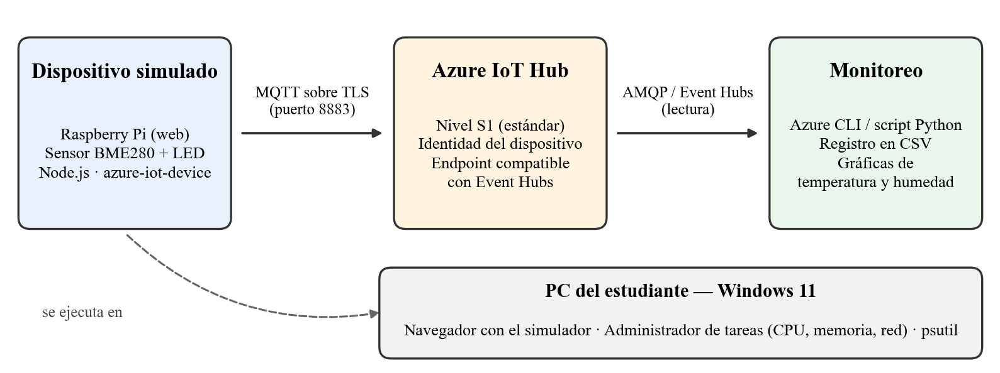
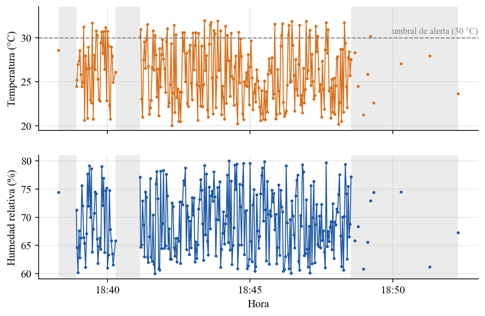
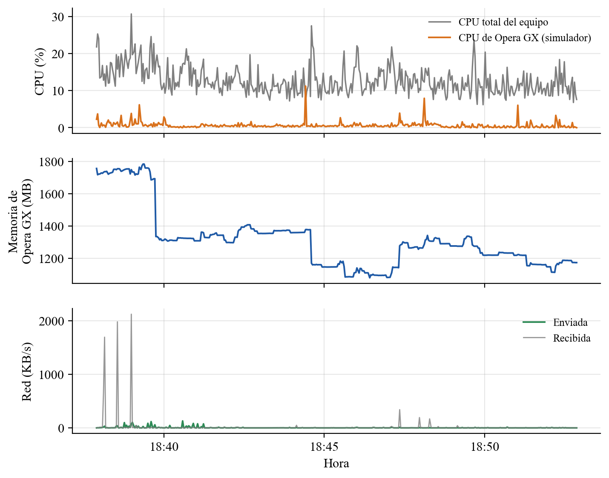

# Raspberry Pi simulado + Azure IoT Hub: monitoreo de telemetría

Primera entrega (semana 3) del módulo **Internet de las cosas**, Facultad de Ingeniería, Diseño e Innovación, Politécnico Grancolombiano.

Un Raspberry Pi simulado en el navegador ([Raspberry Pi Azure IoT Online Simulator](https://azure-samples.github.io/raspberry-pi-web-simulator/)), con un sensor BME280 y un LED, envía temperatura y humedad a **Azure IoT Hub** por MQTT. Este repositorio contiene los scripts que:

1. leen esa telemetría desde el *endpoint* de IoT Hub compatible con Event Hubs;
2. registran al mismo tiempo el consumo del equipo (CPU, memoria y red) para compararlo con el Administrador de tareas de Windows;
3. generan las gráficas y las estadísticas que se usan en el artículo.



## Estructura

| Ruta | Contenido |
|---|---|
| `monitor.py` | Registra la telemetría de IoT Hub y los indicadores del sistema operativo en `datos/`. |
| `graficas.py` | Genera las figuras y el resumen estadístico en `graficas/`. |
| `.env.ejemplo` | Plantilla de configuración. Se copia como `.env`, que no se versiona. |
| `datos/` | CSV de la corrida analizada (8 de noviembre de 2026, 15 minutos). |
| `graficas/` | Figuras 7 y 8 del artículo y `resumen.txt` con los valores de las tablas. |
| `docs/` | Diagrama de arquitectura. |

## Requisitos

- Python 3.10 o superior.
- Una suscripción de Azure con un IoT Hub y un dispositivo registrado. El nivel **F1 (gratuito)** es suficiente.
- Windows. La medición de memoria por proceso imita la columna "Memoria" del Administrador de tareas.

```bash
pip install -r requirements.txt
```

## Configuración

1. **Simulador.** En el IoT Hub, ve a *Dispositivos*, abre tu dispositivo y copia la **cadena de conexión principal** (`HostName=...;DeviceId=...;SharedAccessKey=...`). Pégala en la línea `const connectionString = '...'` del simulador web.
2. **Script.** Copia `.env.ejemplo` como `.env` y escribe la cadena del **endpoint compatible con Event Hubs**. Esta cadena empieza por `Endpoint=sb://` y no es la misma del dispositivo.

   Si el portal no muestra la página *Puntos de conexión integrados*, genera la cadena desde [Azure Cloud Shell](https://shell.azure.com) (Bash), reemplazando `<hub>` por el nombre de tu hub:

   ```bash
   echo "Endpoint=$(az iot hub show -n <hub> --query properties.eventHubEndpoints.events.endpoint -o tsv);SharedAccessKeyName=service;SharedAccessKey=$(az iot hub policy show --hub-name <hub> -n service --query primaryKey -o tsv);EntityPath=$(az iot hub show -n <hub> --query properties.eventHubEndpoints.events.path -o tsv)"
   ```

> Ninguna de las dos cadenas debe subirse al repositorio: ambas contienen claves de acceso. `.env` está en `.gitignore`.

## Uso

```bash
# 1. Iniciar el monitoreo (por defecto 15 minutos) y luego pulsar Run en el simulador
python monitor.py --minutos 15

# Otro navegador para el simulador (por defecto opera.exe)
python monitor.py --navegador chrome.exe

# Solo indicadores del equipo, sin Azure (para probar)
python monitor.py --solo-sistema --minutos 1

# 2. Generar gráficas y resumen
python graficas.py
```

Cada corrida de `monitor.py` empieza con archivos limpios. Si ya existen CSV de una corrida anterior, los renombra como `*_anterior_HHMMSS.csv`.

### Archivos generados

- `datos/telemetria.csv`: hora de recepción, hora de encolado en IoT Hub, dispositivo, `messageId`, temperatura, humedad y alerta (> 30 °C).
- `datos/sistema.csv`: cada 2 s, CPU total, memoria del equipo, CPU y memoria del navegador (conjunto de trabajo privado, USS) y red enviada/recibida.
- `graficas/figura7_telemetria.png`, `graficas/figura8_recursos.png` y `graficas/resumen.txt`.

## Resultados de la corrida incluida

| Indicador | Valor |
|---|---|
| Mensajes recibidos | 274, sin pérdidas ni duplicados |
| Periodo mediano de envío | 2,0 s |
| Retraso IoT Hub → equipo | 1,61 s promedio (máximo 2,09 s) |
| Temperatura | 20,06 a 31,97 °C, promedio 25,90 °C; 48 alertas > 30 °C |
| Humedad | 60,02 a 80,00 %, promedio 69,04 % |
| CPU del navegador (Opera GX) | 0,64 % promedio |
| Memoria del navegador vs. Administrador de tareas | 1 759,2 MB vs. 1 754,5 MB (diferencia de 0,3 %) |



Las zonas grises son intervalos de más de 5 s sin mensajes. Cuando la pestaña del simulador queda en segundo plano, el navegador frena los temporizadores de JavaScript y el envío baja hasta un mensaje por minuto. **Para medir, mantén visible la pestaña del simulador.**



## Notas

- Si `monitor.py` falla con `Invalid Endpoint on the Connection String`, el `.env` tiene la cadena del dispositivo en lugar de la del endpoint compatible con Event Hubs.
- Algunos antivirus inspeccionan el tráfico HTTPS y hacen fallar la CLI de Azure local con errores de certificado. En ese caso, usa Cloud Shell.
- Un IoT Hub en nivel **Standard (S1)** tiene costo mensual y no puede bajarse a F1. Elimínalo al terminar si no lo vas a usar.

## Autor

Julián David Quintero Herrera. Docente: Ing. John Olarte Ramos.
